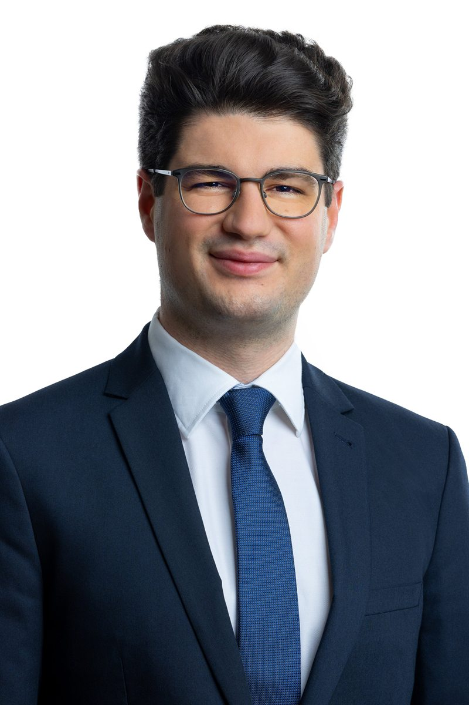
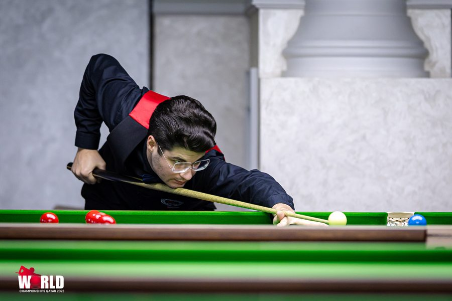

::: {.about-intro}
::: {.about-copy}
## Biography

Philipp Koch is an economist who uses econometrics, machine learning, and data science to understand past and present economic development. He is Head of Data Science at [EcoAustria](https://ecoaustria.ac.at/){target="_blank"} in Vienna, teaches at the Vienna University of Economics and Business, and is an affiliate member of the [Center for Collective Learning](https://centerforcollectivelearning.org/){target="_blank"} (IAST, Toulouse School of Economics), where he did his PhD.

Much of his work builds new measurements where conventional statistics are missing: historical GDP per capita estimated from the biographies of famous people ([PNAS, 2024](data/historical-gdp/index.qmd)), and trade in digital products estimated from corporate revenues ([Nature Communications, 2024](https://www.nature.com/articles/s41467-024-49141-z){target="_blank"}). His research covers economic development, structural change, economic complexity, economic geography, innovation, economic history, and global value chains. At [EcoAustria](https://ecoaustria.ac.at/){target="_blank"}, he applies these methods to Austrian policy questions on trade, industry, digitalisation, and AI.

Next to his academic ambitions, Philipp acts as President of a snooker club in Vienna ([HSEBC](https://www.hsebc.at/){target="_blank"}) and competes regularly in national and international tournaments.
:::

::: {.about-photos}
{.about-portrait fig-alt="Portrait of Philipp Koch" width="800" height="1200"}

{.about-snooker fig-alt="Philipp Koch playing snooker at the 2023 World Championships in Qatar" width="900" height="600"}
:::
:::

## Affiliations

- Head of Data Science, [EcoAustria](https://ecoaustria.ac.at/){target="_blank"}
- Lecturer, Vienna University of Economics and Business
- PhD and Affiliate Member, [Center for Collective Learning](https://centerforcollectivelearning.org/){target="_blank"}, IAST, Toulouse School of Economics

## Contact

[philipp.koch@ecoaustria.ac.at](mailto:philipp.koch@ecoaustria.ac.at)
